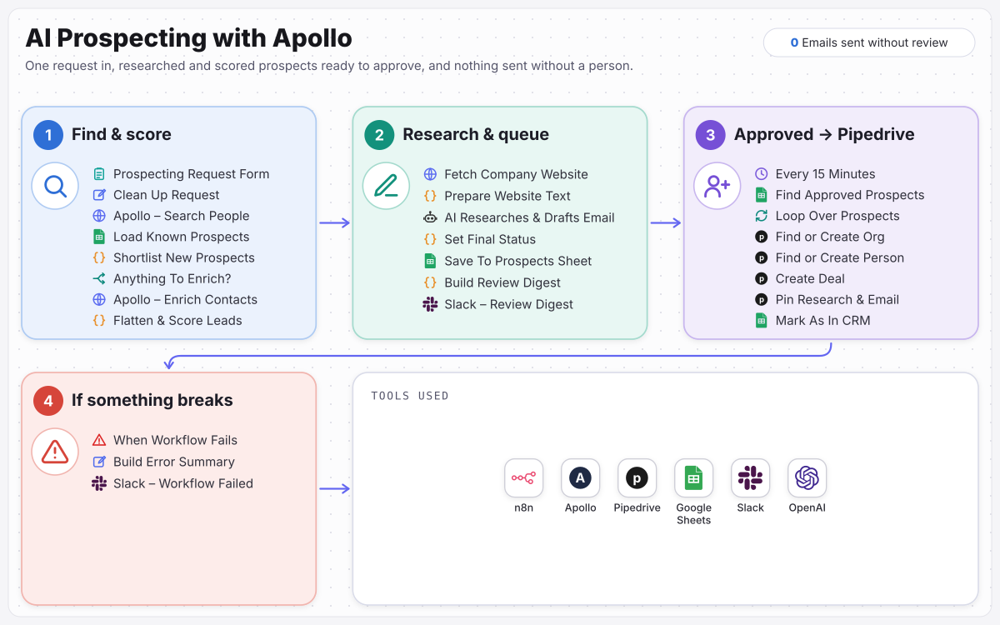

# AI Prospecting with Apollo

Researched, scored prospects with a draft email ready to approve, from one form.

> Built for **Harbourline Payroll Services**, a fictional sample client. The business, people and data are invented; the workflow is complete and runs.

Finds decision-makers in Apollo, scores them by fixed rules, researches each company website with AI and drafts a first email, then queues everyone in a Google Sheet for the team to approve. Approved prospects land in Pipedrive with the research attached. Nothing is sent automatically.

**Full case study:** [ramonvallejera.com/case-study/ai-prospecting-apollo](https://ramonvallejera.com/case-study/ai-prospecting-apollo)

## How it works

1. Request form
2. Apollo search
3. Skip known prospects
4. Enrich
5. Rule-based score
6. AI researches the website and drafts an email
7. Review sheet
8. Approved prospects into Pipedrive

Built an n8n workflow where the sales team fills in one form. Apollo finds matching decision-makers, anyone already in the prospects sheet is skipped, the best are enriched and scored by fixed rules, AI reads each company website and drafts a grounded first email, and everything waits in a Google Sheet for the team to approve. Every 15 minutes, approved prospects are added to Pipedrive with the research pinned to a new deal.

## What's in this repo

| File | What it is |
|---|---|
| `workflow.json` | The n8n workflow, 45 nodes, ready to import |
| `docs/process-map.svg` | The process map from the case study |

Triggers: `Prospecting Request Form`, `Every 15 Minutes`, `When Workflow Fails`.

## Set it up

1. In n8n, open **Workflows → Import from File** and choose `workflow.json`.
2. Create these credentials and select them on the nodes that need them:

   - Pipedrive (6 nodes)
   - Google Sheets (OAuth2) (5 nodes)
   - Slack (OAuth2) (4 nodes)
   - Header auth (Apollo API key) (2 nodes)
   - OpenAI (1 node)

3. Replace the placeholders with your own records:

   - `YOUR_GOOGLE_SHEET_ID` (5×)
   - `YOUR_SLACK_CHANNEL_ID` (4×): the channel that receives alerts and approvals

4. Run it once with test data, then activate it.

Tools: n8n, Apollo, Pipedrive, Google Sheets, Slack, OpenAI.

## Notes

- Credentials, webhook IDs, pinned test data and account-specific IDs were removed before publishing. n8n assigns new webhook URLs on import.
- Built by [Ramon Vallejera Jr.](https://ramonvallejera.com), AI Automation Engineer. Questions or a build like this for your team: [ramonvallejera.com/contact](https://ramonvallejera.com/contact).
